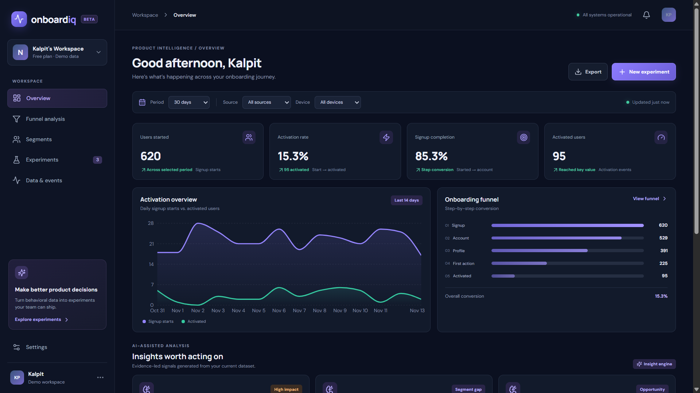
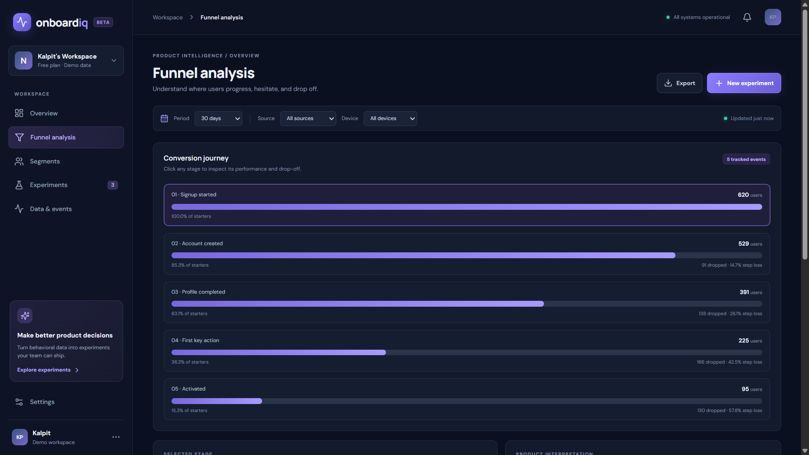
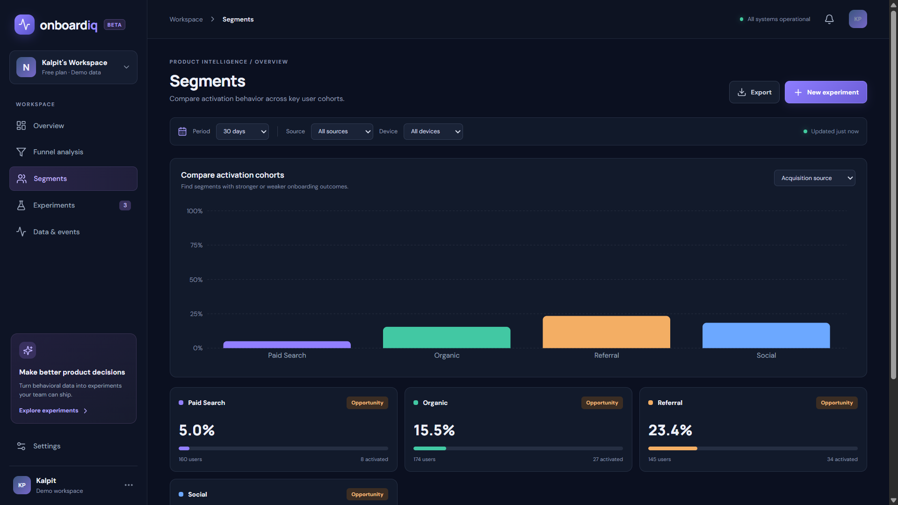
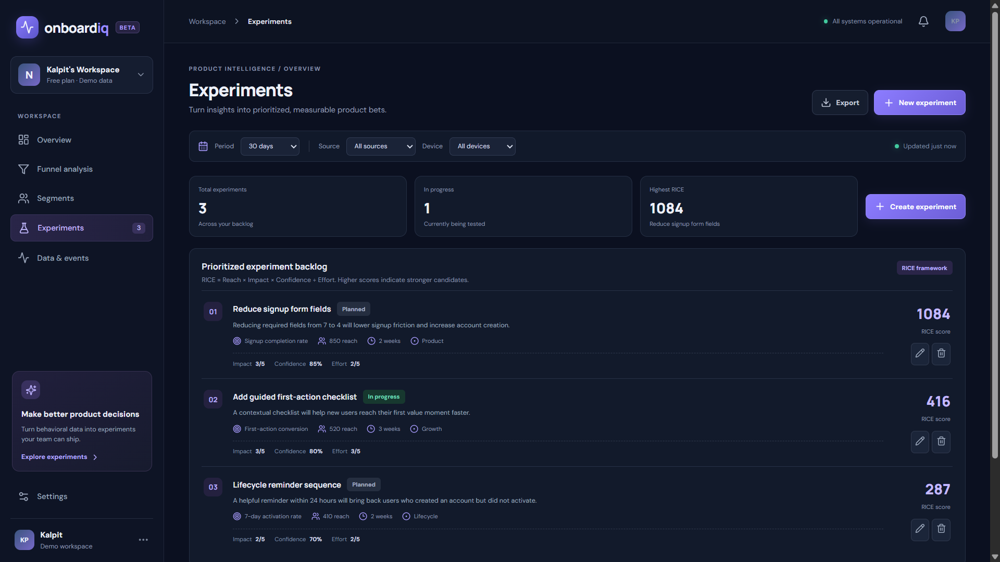
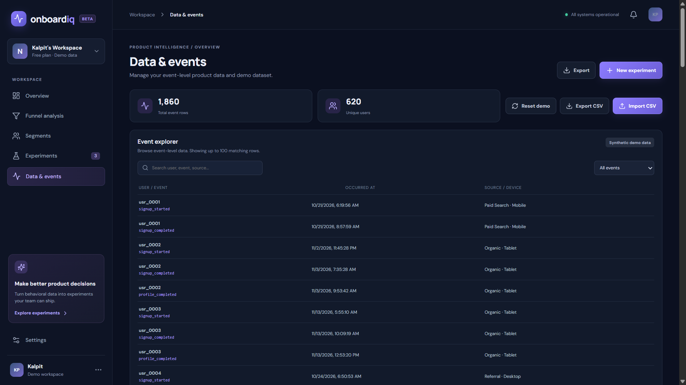

# OnboardIQ – AI-Powered Onboarding Funnel Analyzer

An interactive onboarding analytics dashboard that helps product teams understand user drop-offs, identify activation bottlenecks, and prioritize experiments to improve product onboarding.

## 🚀 Overview

OnboardIQ transforms onboarding funnel data into actionable product insights. It enables teams to analyze conversion patterns across different user segments, uncover friction points, and make data-informed decisions to improve user activation.

Built as a product management portfolio project using simulated user analytics data.

## 📸 Application Screenshots

### 1. Dashboard Overview

Get a quick overview of onboarding performance, key metrics, conversion rates, and user activity.

### 2. Funnel Analysis

Visualize user progression through onboarding stages and identify where users drop off.

### 3. User Segmentation

Analyze onboarding behavior across acquisition sources, devices, and user types.

### 4. AI-Powered Insights

Discover behavioral patterns, identify onboarding bottlenecks, and generate actionable recommendations.

### 5. Experiment Prioritization

Manage activation experiments and prioritize opportunities using the RICE framework.

## ✨ Key Features

### 📊 Onboarding Funnel Analytics
- Visualize user progression across onboarding stages.
- Track conversion rates and drop-offs at each step.
- Identify stages with the highest user abandonment.
- Monitor key activation metrics.

### 🔍 User Segmentation

Analyze onboarding performance across multiple dimensions:

- **Acquisition Source:** Organic, Paid, Referral, and more.
- **Device:** Desktop, Mobile, and Tablet.
- **User Type:** Different user cohorts and categories.

### 🤖 AI-Powered Insights

- Automatically surface behavioral patterns from funnel data.
- Identify major onboarding bottlenecks.
- Generate actionable recommendations based on observed drop-offs.
- Highlight opportunities to improve user activation.

> **Note:** The current demo uses a deterministic, rule-based insights engine rather than a live LLM integration.

### 🎯 Experiment Prioritization

Designed and prioritized three activation experiments using the RICE framework:

| Experiment | Objective |
|---|---|
| Simplified Signup Flow | Reduce friction during registration |
| Guided Onboarding Checklist | Help users complete their first key action |
| Onboarding Reminder Emails | Re-engage users who abandon onboarding |

Each experiment includes:

- Hypothesis
- Reach
- Impact
- Confidence
- Effort
- RICE score
- Success metrics
- Proposed testing duration

### 🛠️ Additional Features

- Interactive dashboard with responsive UI.
- CSV data import and export.
- Experiment creation, editing, and deletion.
- Persistent browser storage using localStorage.
- Filters and segment-based analytics.

## 🧰 Tech Stack

| Category | Technologies |
|---|---|
| Frontend | React.js, JavaScript |
| Build Tool | Vite |
| Charts | Recharts |
| Icons | Lucide React |
| Styling | CSS |
| Data Persistence | Browser localStorage |
| Deployment | Vercel |

## 📸 Application Preview

Add screenshots of your deployed application here.

Suggested screenshots:

1. Dashboard overview
2. Onboarding funnel visualization
3. User segmentation analytics
4. AI-powered insights
5. Experiment prioritization dashboard

## 📁 Project Purpose

This project demonstrates practical product management concepts through a working analytics application, including:

- Funnel analysis and conversion optimization.
- Behavioral segmentation.
- Data-driven problem identification.
- Hypothesis-driven experimentation.
- RICE-based prioritization.
- Defining measurable success metrics.

## 🔮 Future Improvements

- Integrate real product analytics data.
- Add cloud database storage and user authentication.
- Integrate an LLM for natural-language insights.
- Support custom funnel creation.
- Add cohort analysis and retention tracking.
- Enable collaborative experiment management.

## ⚠️ Data & Implementation Notes

- The application currently uses simulated analytics data.
- Changes to experiments and imported data are stored in browser localStorage.
- Data is browser-specific and is not synchronized across devices.
- The insights engine uses predefined analytical rules; it does not currently call an external AI API.

## 👨‍💻 Author

**Kalpit Parmar**

Associate Product Manager | AI Products | B2B SaaS

- LinkedIn: [linkedin.com/in/kalpitparmar](https://linkedin.com/in/kalpitparmar)
---

*Built to explore how product analytics and structured experimentation can improve user onboarding and activation.*
